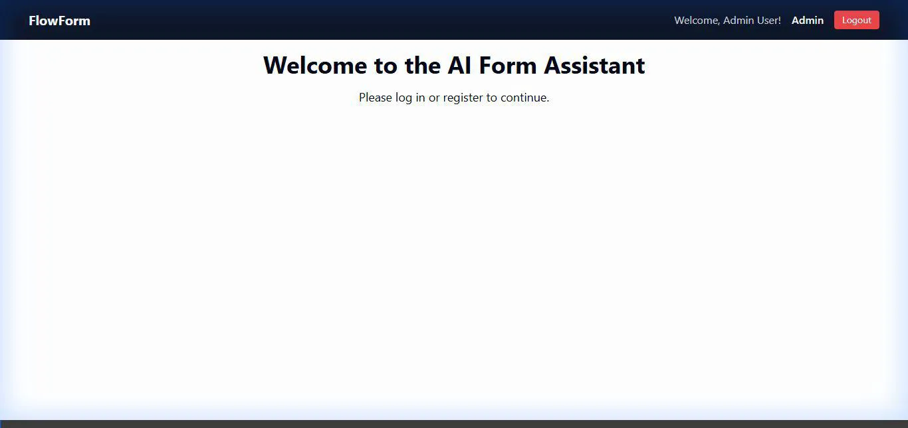
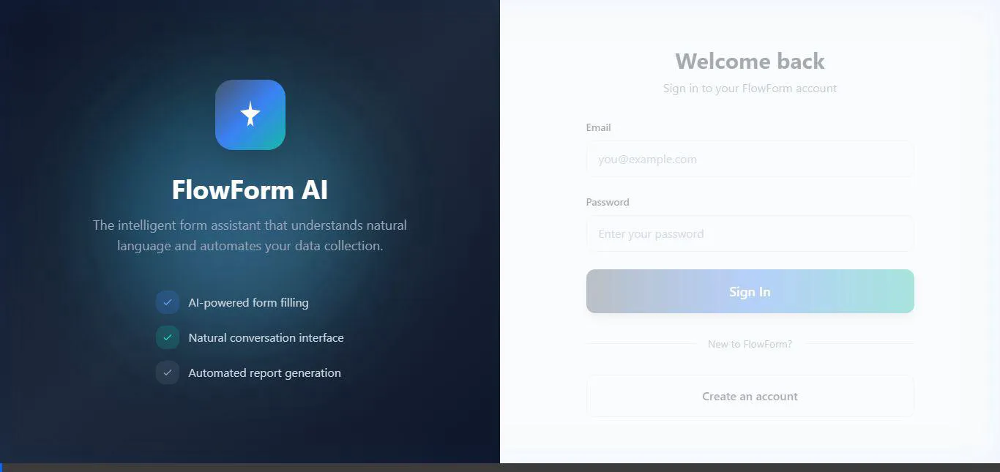

# 🤖 FormFlow AI - Intelligent Conversational Form Assistant

<div align="center">

**An AI-powered conversational assistant that automates form filling, analysis, and report generation using advanced language models.**

[](https://www.python.org/downloads/)
[](https://fastapi.tiangolo.com/)
[](https://nextjs.org/)
[](https://opensource.org/licenses/MIT)

[🎬 Demos](#-demo-videos) • [🌟 Features](#-key-features) • [🚀 Quick Start](#-quick-start) • [🏗️ Architecture](#️-architecture)

</div>

---

## 🎬 Demo Videos

### Admin Dashboard
<div align="center">



*Admin panel walkthrough - Users, Contexts, Forms, Responses and Assignments*

</div>

### AI Chat Form Filling
<div align="center">



*Conversational form filling - AI extracts data from natural language and fills incident reports*

</div>

---

## 🌟 Key Features

### 🧠 AI-Powered Intelligence
- **Smart Form Prediction**: Automatically identifies the correct form based on user intent
- **Multi-Field Extraction**: Extracts multiple data points from a single message
- **Confidence Tracking**: Provides transparency with confidence scores and reasoning
- **Context-Aware**: Remembers conversation history for seamless interactions

### 📝 Intelligent Form Filling
- Natural language conversation interface (Portuguese & English)
- Support for multiple form types (incidents, evaluations, reports)
- Real-time field validation with AI assistance
- Auto-population from previous conversations

### 📊 Advanced Analytics & Reporting
- Automated security and incident reports
- Trend analysis and pattern recognition
- Performance metrics and statistics
- Multi-format export (PDF, Excel, JSON)

### 🤖 Specialized AI Agent System
- **Router Agent**: Classifies user intent and routes to appropriate handler
- **Form Predictor**: Identifies the correct form with confidence scoring
- **Form Filler**: Guides users through form completion conversationally
- **Report Generator**: Creates detailed reports with AI-powered insights
- **Validation Agent**: Ensures data quality and completeness

### 🌐 Multi-Channel Integration
- ✅ **Web Interface**: Modern, responsive Next.js frontend
- ✅ **WhatsApp Bot**: Fill forms via WhatsApp conversations
- ✅ **REST API**: Full API access for integrations
- 🔄 **Coming Soon**: Telegram, Slack, Microsoft Teams

---

## 🏗️ Architecture

```
┌─────────────────────────────────────────────────────────────────┐
│                        FormFlow AI System                        │
└─────────────────────────────────────────────────────────────────┘
                                  │
        ┌─────────────────────────┼─────────────────────────┐
        │                         │                         │
┌───────▼────────┐      ┌─────────▼────────┐      ┌────────▼───────┐
│   Frontend     │      │   Backend API    │      │   Database     │
│   (Next.js)    │◄────►│   (FastAPI)      │◄────►│   (MongoDB)    │
│   TypeScript   │      │   Python 3.11+   │      │   + Redis      │
└────────────────┘      └──────────┬───────┘      └────────────────┘
                                   │
                    ┌──────────────┼──────────────┐
                    │              │              │
            ┌───────▼──────┐  ┌────▼─────┐  ┌────▼────────┐
            │  AI Agents   │  │ WhatsApp │  │  Storage    │
            │  - Router    │  │   Bot    │  │  (MinIO/S3) │
            │  - Predictor │  │ Puppeteer│  │             │
            │  - Filler    │  │          │  │             │
            │  - Reporter  │  └──────────┘  └─────────────┘
            └──────────────┘
                    │
        ┌───────────┼───────────┐
        │           │           │
   ┌────▼────┐ ┌───▼────┐ ┌────▼────┐
   │ Gemini  │ │ OpenAI │ │LangChain│
   │   API   │ │  API   │ │Framework│
   └─────────┘ └────────┘ └─────────┘
```

### Technical Stack

**Backend**
- 🐍 **FastAPI**: High-performance async Python framework
- 🗄️ **MongoDB**: Flexible NoSQL database for forms and responses
- ⚡ **Redis**: Session management and caching
- 🤖 **Google Gemini & OpenAI**: Dual LLM support
- 🔗 **LangChain & LangGraph**: AI agent orchestration
- ✅ **Pydantic v2**: Advanced data validation

**Frontend**
- ⚛️ **Next.js 14**: React framework with SSR/SSG
- 📘 **TypeScript**: Type-safe development
- 🎨 **Tailwind CSS**: Utility-first styling
- 📋 **React Hook Form**: Optimized form management

**Infrastructure**
- 🐳 **Docker & Docker Compose**: Containerized deployment
- 📦 **MinIO**: S3-compatible object storage
- 🔒 **JWT Authentication**: Secure token-based auth
- 🚦 **Rate Limiting**: DDoS protection

---

## 🚀 Quick Start

### Prerequisites
- Docker & Docker Compose (recommended)
- Python 3.11+ (for local development)
- Node.js 18+ (for frontend development)

### 🐳 Docker Setup (Recommended)

```bash
# 1. Clone the repository
git clone https://github.com/YOUR_USERNAME/formflow-ai.git
cd formflow-ai

# 2. Configure environment variables
cp .env.example .env
# Edit .env with your API keys

# 3. Start all services
docker-compose up -d

# 4. Access the application
# Frontend: http://localhost:3000
# API Docs: http://localhost:8002/docs
# MinIO: http://localhost:9001
```

### ⚙️ Local Development Setup

**Backend:**
```bash
python -m venv venv
source venv/bin/activate  # Windows: venv\Scripts\activate
pip install -r requirements.txt
uvicorn app.main:app --reload --port 8002
```

**Frontend:**
```bash
cd frontend
npm install
npm run dev
```

**WhatsApp Bot:**
```bash
cd whatsapp-test-server
npm install
npm start
```

---

## 📋 Environment Configuration

Create a `.env` file based on `.env.example`:

```env
# Database
MONGODB_URL=mongodb://localhost:27017
DATABASE_NAME=formflow_ai

# Redis Cache
REDIS_URL=redis://localhost:6379/0

# AI Models (Get your keys from providers)
GEMINI_API_KEY=your_gemini_api_key_here
OPENAI_API_KEY=your_openai_api_key_here

# S3 Storage
S3_BUCKET_NAME=formflow-uploads
S3_ACCESS_KEY=minioadmin
S3_SECRET_KEY=minioadmin
S3_ENDPOINT_URL=http://localhost:9000

# Security
SECRET_KEY=your-super-secret-key-min-32-characters
ACCESS_TOKEN_EXPIRE_MINUTES=60
ALGORITHM=HS256

# CORS
ALLOWED_ORIGINS=["http://localhost:3000","http://localhost:8002"]
```

---

## 💡 Usage Examples

### Web Interface

1. **Start a conversation:**
   ```
   User: "I need to report a workplace incident"
   AI: "🟢 I've identified that you want to fill an incident report (95% confidence).
        Let's get started. What is your name?"
   ```

2. **Provide information naturally:**
   ```
   User: "My name is John Silva, phone (11) 98765-4321, email john@company.com"
   AI: "✅ Great! I've captured:
        • Name: John Silva
        • Phone: (11) 98765-4321
        • Email: john@company.com

        Now, where did the incident occur?"
   ```

### WhatsApp Integration

```
[WhatsApp Chat]
You: "Hi, need to fill a form"
Bot: "👋 Hello! I'm your FormFlow AI assistant.
      What type of form would you like to fill?"

You: "Safety incident at construction site"
Bot: "🟢 Starting incident report form.
      What's your full name?"
```

### REST API

```bash
# Login
curl -X POST "http://localhost:8002/auth/login" \
  -H "Content-Type: application/x-www-form-urlencoded" \
  -d "username=user@example.com&password=password123"

# Send message to AI
curl -X POST "http://localhost:8002/enhanced_conversation/message" \
  -H "Authorization: Bearer YOUR_TOKEN" \
  -H "Content-Type: application/json" \
  -d '{
    "session_id": "user-123",
    "user_message": "I need to report an incident"
  }'
```

---

## 🛠️ API Documentation

### Authentication
```http
POST   /auth/register          # Create new user account
POST   /auth/login             # Login and get JWT token
POST   /auth/refresh           # Refresh access token
```

### Conversations
```http
POST   /enhanced_conversation/message       # Send message to AI
GET    /enhanced_conversation/sessions      # List user sessions
DELETE /enhanced_conversation/session/{id}  # Clear session
```

### Forms Management
```http
GET    /forms-management/templates           # List form templates
POST   /forms-management/templates           # Create template (admin)
GET    /forms-management/responses           # List user responses
GET    /forms-management/responses/{id}      # Get specific response
POST   /forms-management/responses           # Submit form response
```

### Analytics & Reports
```http
POST   /reports/generate                     # Generate AI report
GET    /reports/analytics                    # Get analytics data
GET    /analytics/dashboard                  # Dashboard metrics
```

**📖 Full API Documentation:** Visit `http://localhost:8002/docs` after starting the backend

---

## 🗂️ Project Structure

```
formflow-ai/
├── 📁 app/                           # Backend FastAPI application
│   ├── agents/                       # AI agent system
│   │   ├── nodes/                    # Individual agent nodes
│   │   │   ├── router.py             # Intent classification
│   │   │   ├── form_filler.py        # Form filling logic
│   │   │   └── clarification.py      # Handles ambiguity
│   │   ├── prompts/                  # Centralized prompt management
│   │   ├── reasoning/                # Confidence & reasoning system
│   │   ├── observability/            # Tracing & debugging
│   │   └── orchestrator.py           # Agent workflow orchestration
│   ├── routers/                      # API route handlers
│   ├── services/                     # Business logic layer
│   ├── models/                       # Database models
│   ├── schemas/                      # Pydantic schemas
│   └── config/                       # Configuration management
│
├── 📁 frontend/                      # Next.js frontend
│   ├── src/
│   │   ├── components/               # React components
│   │   ├── pages/                    # Next.js pages
│   │   ├── hooks/                    # Custom React hooks
│   │   └── styles/                   # CSS and Tailwind
│   └── public/                       # Static assets
│
├── 📁 whatsapp-test-server/          # WhatsApp bot service
│   ├── bot.js                        # Bot logic
│   └── controllers/                  # Message handlers
│
├── 📁 docs/                          # Documentation
│   ├── images/                       # Logo and assets
│   ├── screenshots/                  # Application screenshots
│   └── architecture/                 # Architecture diagrams
│
├── 📁 tests/                         # Test suites
│   ├── unit/                         # Unit tests
│   └── integration/                  # Integration tests
│
├── 🐳 docker-compose.yml             # Docker services definition
├── 📦 requirements.txt               # Python dependencies
├── 📝 .env.example                   # Environment template
└── 📖 README.md                      # This file
```

---

## 🔒 Security Features

- ✅ **JWT Authentication** with secure token refresh
- ✅ **Bcrypt Password Hashing** (12 rounds)
- ✅ **Input Validation** via Pydantic schemas
- ✅ **Rate Limiting** to prevent abuse
- ✅ **CORS Protection** with configurable origins
- ✅ **SQL Injection Prevention** (NoSQL with sanitization)
- ✅ **XSS Protection** in frontend rendering

---

## 📊 Advanced Features

### 🎯 Confidence Tracking System
The AI provides transparency by showing confidence levels:
- 🟢 **High Confidence (>80%)**: Direct form selection
- 🟡 **Medium Confidence (50-80%)**: Confirmation requested
- 🔴 **Low Confidence (<50%)**: Clarification questions asked

### 🔍 Execution Tracing
Full observability into AI decisions:
- Step-by-step reasoning chains
- Performance metrics per agent
- Debug information for developers
- User-friendly explanations

### 📝 Centralized Prompt Management
- Version-controlled prompts
- A/B testing capabilities
- Performance tracking
- Easy optimization

---

## 🧪 Testing

```bash
# Run all tests
pytest tests/ -v

# Run with coverage
pytest tests/ --cov=app --cov-report=html

# Run specific test categories
pytest tests/ -m unit          # Unit tests only
pytest tests/ -m integration   # Integration tests only
```

---

## 📚 Documentation

- 📖 **API Documentation**: Available at `http://localhost:8002/docs` after starting the server
- 🔌 **OpenAPI Schema**: Available at `http://localhost:8002/openapi.json`

---

## 🎯 Roadmap

- [ ] Mobile app (React Native)
- [ ] Telegram bot integration
- [ ] Advanced analytics dashboard with ML predictions
- [ ] PDF form parsing and auto-filling
- [ ] Voice input support
- [ ] Multi-language support (Spanish, English, Portuguese)
- [ ] ERP system integrations (SAP, Oracle)
- [ ] Custom form builder UI

---

## 🤝 Contributing

Contributions are welcome! Please follow these steps:

1. Fork the repository
2. Create a feature branch (`git checkout -b feature/AmazingFeature`)
3. Commit your changes (`git commit -m 'Add some AmazingFeature'`)
4. Push to the branch (`git push origin feature/AmazingFeature`)
5. Open a Pull Request

Please read [CONTRIBUTING.md](docs/CONTRIBUTING.md) for details on our code of conduct and development process.

---

## 📝 License

This project is licensed under the MIT License - see the [LICENSE](LICENSE) file for details.

---

## 👨‍💻 Author

**Your Name**
- 💼 LinkedIn: [Your LinkedIn](YOUR_LINKEDIN_URL)
- 🐙 GitHub: [@yourusername](https://github.com/yourusername)
- 📧 Email: your.email@example.com
- 🌐 Portfolio: [yourportfolio.com](YOUR_PORTFOLIO_URL)

---

## 🙏 Acknowledgments

- Google Gemini API for powerful language understanding
- OpenAI for GPT models
- LangChain team for the excellent agent framework
- FastAPI community for the amazing web framework

---

## 📞 Support

If you have questions or need support:

- 📧 **Email**: support@formflow-ai.com
- 💬 **Issues**: [GitHub Issues](https://github.com/YOUR_USERNAME/formflow-ai/issues)
- 📖 **Documentation**: [Wiki](https://github.com/YOUR_USERNAME/formflow-ai/wiki)
- 💼 **LinkedIn**: [Connect with me](YOUR_LINKEDIN_URL)

---

<div align="center">

**⭐ If you like this project, please give it a star! ⭐**

Made with ❤️ and AI

</div>
# formflow-ai
