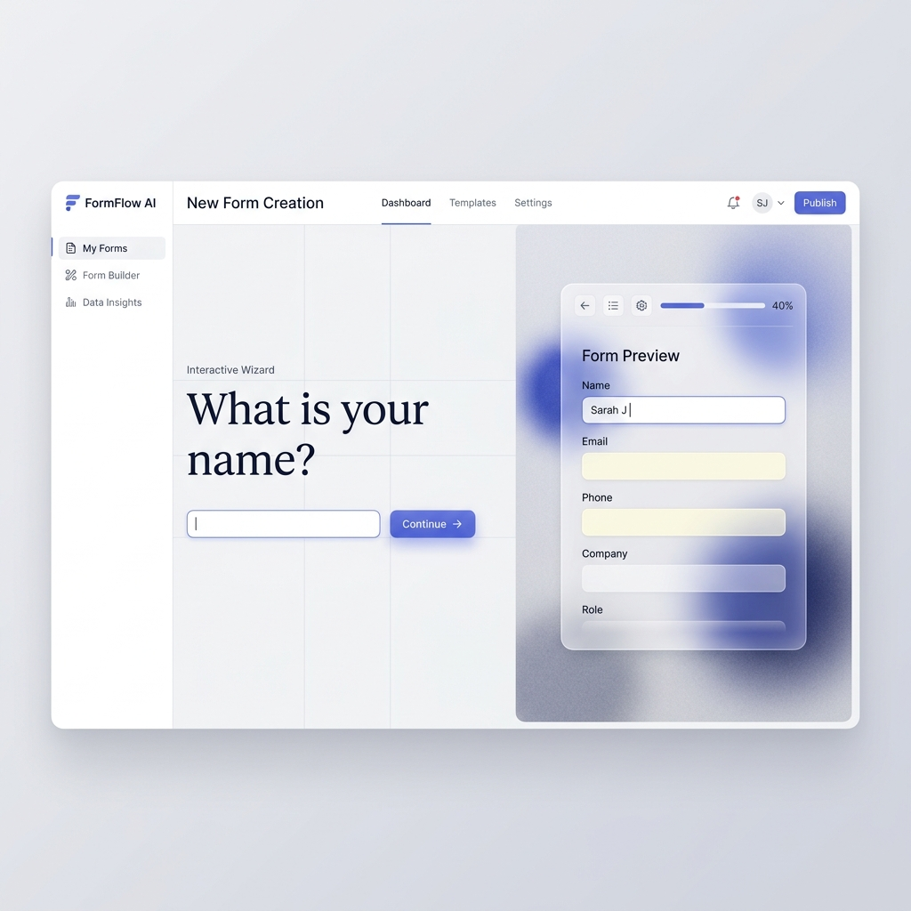

# 🤖 FlowForm AI - Production-Ready Conversational Form Assistant

<div align="center">

**A full-stack, AI-powered conversational assistant that automates form filling, analysis, and report generation using Google Gemini and advanced language models.**

[](https://github.com/YOUR_USERNAME/flowform-ai/actions/workflows/ci.yml)
[](https://www.python.org/downloads/)
[](https://fastapi.tiangolo.com/)
[](https://nextjs.org/)
[](https://www.typescriptlang.org/)
[](https://www.mongodb.com/)
[](https://www.docker.com/)
[](https://opensource.org/licenses/MIT)

[🎬 Demos](#-demo-videos) • [🌟 Features](#-key-features) • [🚀 Quick Start](#-quick-start) • [☁️ Deploy](#️-deployment) • [🏗️ Architecture](#️-architecture) • [🧪 Testing](#-testing)

</div>

---

## ✨ Highlights

> **Production-Ready**: Includes CI/CD pipeline, structured logging, health endpoints, rate limiting, and comprehensive test coverage.

- 🧠 **AI-Powered**: Leverages Google Gemini for intelligent form prediction and conversational filling
- 🎨 **Modern UI**: Typeform-inspired design with Gemini-style chat interface
- 🔒 **Enterprise Security**: JWT auth, role-based access, rate limiting, and security scanning
- 📊 **Observable**: Structured JSON logging, health checks, and metrics endpoints
- 🐳 **Cloud-Native**: Docker-ready with one-click deploy options

---

## 🎬 Live Demo & Previews

**🌐 Live Deployment:** [https://flowform-ai-two.vercel.app](https://flowform-ai-two.vercel.app)

> **Note for Recruiters & Reviewers:** You do **not** need to log in to see the AI in action! The homepage features a live, split-screen **Interactive Wizard Demo** that demonstrates the core natural-language form filling capability instantly.

### Interactive Wizard (Public Demo)
<div align="center">



*The new landing page features a split-screen AI wizard that extracts data from conversation and fills the form in real-time.*

</div>

### Admin Dashboard Walkthrough
<div align="center">


*Complete admin walkthrough - Login, Users, Contexts, Forms, Responses, Assignments, and Analytics*

</div>

---

## 🌟 Key Features

### 🧠 AI-Powered Intelligence
- **Smart Form Prediction**: Automatically identifies the correct form based on user intent
- **Multi-Field Extraction**: Extracts multiple data points from a single message
- **Confidence Tracking**: Provides transparency with confidence scores and reasoning
- **Context-Aware**: Remembers conversation history for seamless interactions

### 📝 Intelligent Form Filling
- Natural language conversation interface
- Support for multiple form types (incidents, evaluations, reports)
- Real-time field validation with AI assistance
- Live progress tracking during form completion

### 📊 Advanced Analytics & Reporting
- Automated incident and security reports
- Trend analysis and pattern recognition
- Performance metrics and statistics
- Multi-format export (PDF, Excel, JSON)

### 🤖 Specialized AI Agent System
| Agent | Purpose |
|-------|---------|
| **Router** | Classifies user intent and routes to appropriate handler |
| **Form Predictor** | Identifies the correct form with confidence scoring |
| **Form Filler** | Guides users through form completion conversationally |
| **Report Generator** | Creates detailed reports with AI-powered insights |

### 🌐 Multi-Channel Integration
- ✅ **Web Interface**: Modern, responsive Next.js frontend
- ✅ **WhatsApp Bot**: Fill forms via WhatsApp conversations
- ✅ **REST API**: Full API access for integrations

---

## 🏗️ Architecture

```
┌─────────────────────────────────────────────────────────────────┐
│                        FormFlow AI System                        │
└─────────────────────────────────────────────────────────────────┘
                                  │
        ┌─────────────────────────┼─────────────────────────┐
        │                         │                         │
┌───────▼────────┐      ┌─────────▼────────┐      ┌────────▼───────┐
│   Frontend     │      │   Backend API    │      │   Database     │
│   (Next.js)    │◄────►│   (FastAPI)      │◄────►│   (MongoDB)    │
│   TypeScript   │      │   Python 3.11+   │      │   + Redis      │
└────────────────┘      └──────────┬───────┘      └────────────────┘
                                   │
                    ┌──────────────┼──────────────┐
                    │              │              │
            ┌───────▼──────┐  ┌────▼─────┐  ┌────▼────────┐
            │  AI Agents   │  │ WhatsApp │  │  Storage    │
            │  (LangGraph) │  │   Bot    │  │  (MinIO/S3) │
            └──────┬───────┘  └──────────┘  └─────────────┘
                   │
        ┌──────────┼──────────┐
        │          │          │
   ┌────▼────┐ ┌───▼────┐ ┌───▼───┐
   │ Gemini  │ │ OpenAI │ │ Redis │
   │   API   │ │  API   │ │ Cache │
   └─────────┘ └────────┘ └───────┘
```

### Technical Stack

| Layer | Technologies |
|-------|-------------|
| **Backend** | FastAPI, Python 3.11+, Pydantic v2 |
| **AI/ML** | Google Gemini, OpenAI, LangChain, LangGraph |
| **Database** | MongoDB, Redis |
| **Frontend** | Next.js 14, TypeScript, Tailwind CSS |
| **Storage** | MinIO (S3-compatible) |
| **Infrastructure** | Docker, Docker Compose |

---

## 🚀 Quick Start

### Prerequisites
- Docker & Docker Compose (recommended)
- Python 3.11+ (for local development)
- Node.js 18+ (for frontend development)

### 🐳 Docker Setup (Recommended)

```bash
# 1. Clone the repository
git clone https://github.com/YOUR_USERNAME/formflow-ai.git
cd formflow-ai

# 2. Configure environment variables
cp .env.example .env
# Edit .env with your API keys (GEMINI_API_KEY or OPENAI_API_KEY)

# 3. Start all services
docker-compose up -d

# 4. Create admin user
docker-compose exec app python create_admin_user.py

# 5. Access the application
# Frontend: http://localhost:3000
# API Docs: http://localhost:8002/docs
# MinIO: http://localhost:9001
```

### Default Credentials
- **Admin**: `admin@example.com` / `admin123`

---

## 📋 Environment Configuration

Create a `.env` file based on `.env.example`:

```env
# Database
MONGODB_URL=mongodb://localhost:27017
DATABASE_NAME=formflow_ai

# Redis Cache
REDIS_URL=redis://localhost:6379/0

# AI Models (at least one required)
GEMINI_API_KEY=your_gemini_api_key_here
OPENAI_API_KEY=your_openai_api_key_here

# Storage (MinIO)
MINIO_ENDPOINT=localhost:9000
MINIO_ACCESS_KEY=minioadmin
MINIO_SECRET_KEY=minioadmin

# Security
JWT_SECRET_KEY=your_secret_key_here
```

---

## 📚 API Documentation

Once the application is running, access the interactive API documentation:

- **Swagger UI**: http://localhost:8002/docs
- **ReDoc**: http://localhost:8002/redoc

### Key Endpoints

| Endpoint | Method | Description |
|----------|--------|-------------|
| `/api/enhanced_conversation/message` | POST | Send message to AI assistant |
| `/api/forms-management/contexts` | GET | List work contexts |
| `/api/forms-management/forms` | GET | List form templates |
| `/api/forms/responses` | GET | List form responses |
| `/api/admin/users` | GET | Admin: List all users |

---

## 🧪 Testing

The project includes a comprehensive test suite covering authentication, user management, and forms APIs.

```bash
# Run all tests
make test

# Run with coverage report
make test-coverage

# Run quality checks (lint + type check + security)
make quality

# Run all checks before committing
make check
```

### Test Coverage

| Module | Coverage |
|--------|----------|
| `app/routers/auth_router.py` | Authentication flows |
| `app/routers/user_router.py` | User management |
| `app/routers/forms_router.py` | Forms CRUD operations |

---

## ☁️ Deployment

### Quick Deploy Options

| Platform | Status |
|----------|--------|
| **Railway** | One-click deploy ready |
| **Render** | Dockerfile supported |
| **Docker** | Full compose setup |

```bash
# Production Docker deployment
docker-compose -f docker-compose.yml up -d --build

# Check health
curl http://localhost:8000/health
curl http://localhost:8000/ready
```

📖 See [docs/DEPLOYMENT.md](docs/DEPLOYMENT.md) for detailed deployment instructions.

---

## 📁 Project Structure

```
formflow-ai/
├── app/                    # Backend application
│   ├── agents/             # AI agent implementations
│   ├── routers/            # API route handlers
│   ├── services/           # Business logic
│   ├── models/             # Pydantic models
│   └── main.py             # FastAPI app entry
├── frontend/               # Next.js frontend
│   ├── src/
│   │   ├── pages/          # Page components
│   │   ├── components/     # Reusable components
│   │   └── styles/         # CSS styles
├── whatsapp-test-server/   # WhatsApp bot
├── docker-compose.yml      # Docker configuration
└── requirements.txt        # Python dependencies
```

---

## 🔒 Security

- JWT-based authentication with bcrypt password hashing
- Role-based access control (Admin, User roles)
- Rate limiting on API endpoints
- CORS configuration for frontend

---

## 🤝 Contributing

Contributions are welcome! Please feel free to submit a Pull Request.

1. Fork the repository
2. Create your feature branch (`git checkout -b feature/AmazingFeature`)
3. Commit your changes (`git commit -m 'Add some AmazingFeature'`)
4. Push to the branch (`git push origin feature/AmazingFeature`)
5. Open a Pull Request

---

## 📄 License

This project is licensed under the MIT License - see the [LICENSE](LICENSE) file for details.

---

<div align="center">

**Built with ❤️ for productive teams**

</div>
